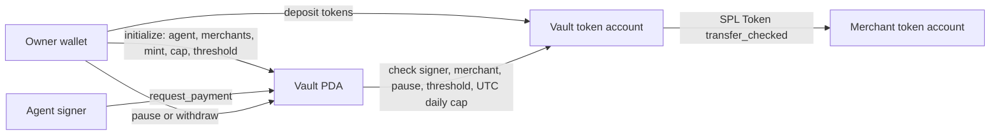
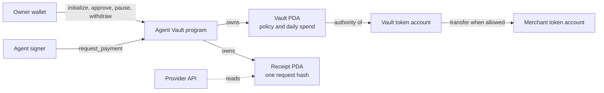

# Agent Vault (Solana)

Agent Vault is a spending account for AI agents that pays permitted API providers with a test USD stablecoin on Solana without giving the agent a free-spending wallet. An Anchor program holds the tokens in a PDA-controlled vault. The owner sets an agent signer, up to five permitted merchants, a daily spending cap and an approval threshold. The agent can request payments that are paid, held for approval, or rejected with an on-chain receipt.

Built for the [MLH Solana Hackathon](https://events.mlh.com/events/15200-solana-hackathon), November 6–8, 2026. The current milestone is the **on-chain policy program plus deterministic AI-agent demo**. The API and dashboard are not part of this submission. **Demo video (96 s): <https://youtu.be/O_oo8S2hwWE>.** The program and demo scenarios are deployed on devnet (see [Devnet deployment](#devnet-deployment)).

## How it works



The vault PDA is derived from `['vault', owner public key]`. Its associated token account holds the selected mint. `daily_limit` and payment amounts are in the mint's **base units**; for a six-decimal token, `1_000_000` units equal one token. The limit resets at midnight UTC, using the on-chain clock. The merchant restriction checks the owner of the recipient token account, so the merchant can receive to any of its accounts for the selected mint. The program currently supports the classic SPL Token program, not Token-2022.

### Why Solana

Solana is part of the product boundary, not just the transport:

| Solana property | Agent Vault behavior | What a judge can verify |
| --- | --- | --- |
| Shared verification without a trusted intermediary | The client can verify the on-chain `Receipt` before returning a paid resource. | Receipt account and transaction logs |
| Durable, shared history | Every payment attempt creates a receipt, including policy rejections. | `Paid`, `Pending`, and `Rejected` receipt states |
| Public, reusable rules | The vault PDA enforces the agent, merchant list, pause state, mint, and daily cap. | Program ID and account constraints |
| Fast, low-value settlement | The design targets per-request payments in token base units. | Ten devnet transactions measured below |
| Composable account data | A provider or dashboard can read receipts without permission from the API operator. | `getProgramAccounts` filtered by vault |

### Account map



| Account | PDA seeds | Created/paid by | Purpose |
| --- | --- | --- | --- |
| `Vault` | `["vault", owner]` | Owner | Immutable agent, merchants, mint, cap, threshold, and pause state |
| `Receipt` | `["receipt", vault, request_hash]` | Agent | Decision, amount, merchant, timestamps, and replay-resistant request hash |
| Vault token account | Associated token account for `Vault` and `mint` | Owner | Holds the configured payment token |

`request_payment` writes both the receipt and `spent_today`, so requests from one vault are serialized by that shared account. Different vaults do not share that account and can be processed independently.

| Instruction | Authorized signer | Action |
| --- | --- | --- |
| `initialize` | Owner | Creates vault and token account; sets agent, up to five merchants, mint, daily limit and approval threshold |
| `request_payment` | Configured agent | Creates a unique receipt and pays immediately, leaves pending, or rejects without transferring |
| `approve_payment` | Owner | Rechecks pause and daily limit, then settles a pending receipt and transfers tokens |
| `reject_payment` | Owner | Settles a pending receipt as owner-rejected |
| `agent_pay` | Configured agent | Compatibility route that transfers after checking recipient, pause state, approval threshold and daily cap; amounts above the threshold fail with `ApprovalRequired` and must use `request_payment` |
| `set_paused` | Owner | Stops or resumes agent payments |
| `owner_withdraw` | Owner | Sends vault tokens to an owner-controlled token account, even while paused |

The program does not verify an API invoice or a `402` response. That link belongs in the next client and API milestone. Do not present the current code as a complete autonomous payment product.

## Build and test locally

Requirements: Rust 1.89, Solana CLI, Anchor 1.2.2 and the Solana SBF tools. The project pins the Rust toolchain in `rust-toolchain.toml`.

```bash
NO_DNA=1 anchor build
NO_DNA=1 anchor test
```

The test suite uses LiteSVM and does not spend devnet SOL. It covers authorized payment, rejected agent and merchant substitutions, daily cap, pause, owner withdrawal, and the UTC daily reset. No wallet key is needed for these local tests. The generated program keypair remains in `target/deploy/` and is ignored by Git.

For a network-free verification, `anchor test` is the minimum reproducible check. To exercise the scripts against a local validator instead of devnet:

```bash
# Terminal 1
NO_DNA=1 solana-test-validator

# Terminal 2
solana config set --url localhost
SOLANA_CLUSTER=localnet SOLANA_RPC_URL=http://127.0.0.1:8899 npm run setup:devnet
SOLANA_CLUSTER=localnet SOLANA_RPC_URL=http://127.0.0.1:8899 npm run smoke
```

The local route requires a locally deployed program and `SOLANA_LOCALNET_GENESIS_HASH` for the network guard. If that variable is not configured, use `anchor test` rather than bypassing the guard.

## Devnet demo

The demo workspace contains an idempotent setup script, a Codama client, and a
smoke test. It uses a six-decimal test token; it is not USDC and the demo does
not target mainnet.

After building and deploying the program to devnet with the configured
deployment wallet:

```bash
npm install
npm run generate:client
NO_DNA=1 anchor deploy --provider.cluster devnet
ANCHOR_WALLET=~/.config/solana/id.json npm run setup:devnet
npm run smoke
```

`setup:devnet` creates the four demo keypairs under `keys/`, funds Maria and
the agent from devnet airdrops, creates the mint and token accounts, initializes
the vault, deposits `50_000_000` base units, and writes
`config/devnet.json`. The command can be run again without recreating existing
resources. The keys are ignored by Git; never import them into a mainnet wallet.
`smoke` submits a `0.01`-token `request_payment` and prints the receipt and
transaction signature.

The AI demo runs three fixed, repeatable scenarios:

```bash
npm run agent -- --scenario 1 # allowed, below threshold: Paid
npm run agent -- --scenario 2 # allowed, above threshold: Pending
npm run agent -- --scenario 3 # unlisted provider: Rejected
npm run approve -- <pending-receipt-pda>
npm run verify -- <receipt-pda>
```

The agent calls Claude when `ANTHROPIC_API_KEY` is present and otherwise uses an
explicit deterministic demo decision. In both modes, the selected catalog entry
and amount are validated before signing. Each reason is saved under
`agent/receipts/` and committed in the receipt's `request_hash`.

### AI angle

The agent chooses a paid API from a local catalog, explains the choice, and
requests payment once. Solana enforces the allowlist, daily cap and approval
threshold; the canonical request hash lets anyone verify that the off-chain
reason matches the on-chain commitment.

### DeFi angle

Agent Vault is non-custodial treasury management for autonomous agents. Funds
sit in a PDA-owned token account that no server controls; the owner's risk
policy (merchant allowlist, daily cap, approval threshold and emergency pause)
is enforced by the program on every transfer; large payments are escrowed until
a human co-signs, a lightweight 2-of-2 between agent and owner; and the owner
can withdraw at any time. Every attempt, including rejections, leaves an
auditable on-chain receipt.

## Devnet deployment

- Program: [`41pzYtwB4MJV2c7uyhEqSUYc3awtekzsPiAGLiPr4Fvi`](https://explorer.solana.com/address/41pzYtwB4MJV2c7uyhEqSUYc3awtekzsPiAGLiPr4Fvi?cluster=devnet)
- Vault PDA: [`DnZHqRn8AbCuXG5EBi76PQdRe4vH7EXZ6beF5BQbfhYJ`](https://explorer.solana.com/address/DnZHqRn8AbCuXG5EBi76PQdRe4vH7EXZ6beF5BQbfhYJ?cluster=devnet)
- First paid `request_payment`: [transaction](https://explorer.solana.com/tx/szejdT3YsS2rjWjktkbMLTQVaLgrsbuwQAXMxGYkDD5oiSNg6FEK13vv5QSde4idksxN78Jymqb26GefqxDjLp7?cluster=devnet)

### Measured latency and cost (devnet, not mainnet)

Ten `request_payment` calls of 0.01 test token each, run with `npm run smoke` on November 7, 2026. All ten were paid.

| Metric | Value |
| --- | --- |
| Median time from send to `confirmed` | **897 ms** (range 715–1,233 ms), measured from the client, including RPC round trips |
| Transaction fee | **5,000 lamports** (0.000005 SOL) per payment |
| Receipt rent deposit | 0.00147828 SOL per receipt (163 bytes); refundable only if receipts get a close instruction |

## Security boundaries and current limits

- The owner selects the token mint at initialization. A client must verify the mint address before claiming payments are in USDC.
- The policy currently permits up to **five merchants**. The owner cannot edit the agent, merchant list or cap after initialization. Pausing is the immediate response if an agent signer is compromised.
- `request_payment` records policy decisions in a `Receipt` PDA derived from the vault and request hash; the same hash cannot be submitted twice.
- `agent_pay` and `request_payment` enforce their rules in the program; the API provider and any agent client are outside this boundary.
- Amounts above the approval threshold can only move through `request_payment` + `approve_payment`, which requires the owner's signature. Before this fix, `agent_pay` skipped that check (reported through responsible disclosure); the program deployed on devnet keeps the old behavior until it is redeployed. See [SECURITY.md](SECURITY.md).
- The program has local tests and runs on devnet, but it has not been audited. Use test tokens only.
- Each receipt currently locks approximately `0.00147828 SOL` of refundable rent.
  `close_receipt` is the first planned follow-up; receipts are not closed by
  today's demo.
- Receipts are public: observers can see the amount, merchant, and timestamps. The payment reason remains off-chain; only its `request_hash` is committed. Confidential transfers are a future Token-2022 evaluation, not part of this prototype.
- No private keys or seed phrases belong in this repository. The `.gitignore` excludes local keypairs, environment files and build artifacts.

### Security model

The program verifies the signer for each role, derives the vault and receipt addresses from fixed seeds, checks the configured mint and token-account owners, and uses checked arithmetic for the daily cap. The owner alone can pause, approve, reject, or withdraw; the configured agent cannot change policy. The API and agent process remain outside the chain, and the demo keypairs are local files, so this prototype is not an audited custody system.

## Demo and submission

The two-minute recording plan, rehearsal checklist, English subtitle script,
and submission copy are in [`DEMO.md`](DEMO.md). The live demo is the devnet
program plus the terminal agent; there is no HTTP API or dashboard in this
submission. The x402-shaped API and dashboard remain future work.

## Next milestone

Connect a small API to a client that requests a response, receives a `402`, pays
the configured merchant, and retries with a transaction receipt. Add
`close_receipt` to recover rent, then add a simple owner dashboard and a real
x402 facilitator integration.
