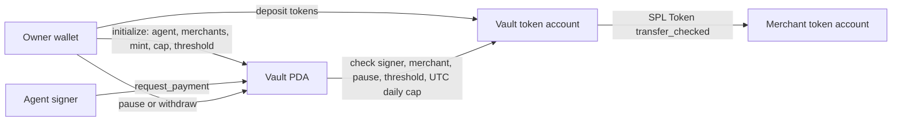

# Agent Vault (Solana)

Agent Vault is an early hackathon prototype for an AI agent that pays permitted API providers with a token on Solana. An Anchor program holds the tokens in a vault account controlled by a PDA. The owner sets an agent signer, up to five permitted merchants, a daily spending cap and an approval threshold. The agent can request payments that are paid, held for approval, or rejected with an on-chain receipt.

Built for the [MLH Solana Hackathon](https://events.mlh.com/events/15200-solana-hackathon), November 6–8, 2026. The current milestone is the **on-chain policy program**. The API, AI agent, dashboard, video, and public submission are still to be built. No devnet deployment has been made from this checkout.

## How it works



The vault PDA is derived from `['vault', owner public key]`. Its associated token account holds the selected mint. `daily_limit` and payment amounts are in the mint's **base units**; for a six-decimal token, `1_000_000` units equal one token. The limit resets at midnight UTC, using the on-chain clock. The merchant restriction checks the owner of the recipient token account, so the merchant can receive to any of its accounts for the selected mint. The program currently supports the classic SPL Token program, not Token-2022.

| Instruction | Authorized signer | Action |
| --- | --- | --- |
| `initialize` | Owner | Creates vault and token account; sets agent, up to five merchants, mint, daily limit and approval threshold |
| `request_payment` | Configured agent | Creates a unique receipt and pays immediately, leaves pending, or rejects without transferring |
| `approve_payment` | Owner | Rechecks pause and daily limit, then settles a pending receipt and transfers tokens |
| `reject_payment` | Owner | Settles a pending receipt as owner-rejected |
| `agent_pay` | Configured agent | Compatibility route that transfers after checking recipient, pause state and daily cap |
| `set_paused` | Owner | Stops or resumes agent payments |
| `owner_withdraw` | Owner | Sends vault tokens to an owner-controlled token account, even while paused |

The program does not verify an API invoice or a `402` response. That link belongs in the next client and API milestone. Do not present the current code as a complete autonomous payment product.

## Build and test locally

Requirements: Rust 1.89, Solana CLI, Anchor 1.2.2 and the Solana SBF tools. The project pins the Rust toolchain in `rust-toolchain.toml`.

```bash
NO_DNA=1 anchor build
NO_DNA=1 anchor test
```

The test suite uses LiteSVM and does not spend devnet SOL. It covers authorized payment, rejected agent and merchant substitutions, daily cap, pause, owner withdrawal, and the UTC daily reset. No wallet key is needed for these local tests. The generated program keypair remains in `target/deploy/` and is ignored by Git.

## Devnet demo

The demo workspace contains an idempotent setup script, a Codama client, and a
smoke test. It uses a six-decimal test token; it is not USDC and the demo does
not target mainnet.

After building and deploying the program to devnet with the configured
deployment wallet:

```bash
npm install
npm run generate:client
NO_DNA=1 anchor deploy --provider.cluster devnet
npm run setup:devnet
npm run smoke
```

`setup:devnet` creates the four demo keypairs under `keys/`, funds Maria and
the agent from devnet airdrops, creates the mint and token accounts, initializes
the vault, deposits `50_000_000` base units, and writes
`config/devnet.json`. The command can be run again without recreating existing
resources. The keys are ignored by Git; never import them into a mainnet wallet.
`smoke` submits a `0.01`-token `request_payment` and prints the receipt and
transaction signature.

## Security boundaries and current limits

- The owner selects the token mint at initialization. A client must verify the mint address before claiming payments are in USDC.
- The policy currently permits up to **five merchants**. The owner cannot edit the agent, merchant list or cap after initialization. Pausing is the immediate response if an agent signer is compromised.
- `request_payment` records policy decisions in a `Receipt` PDA derived from the vault and request hash; the same hash cannot be submitted twice.
- `agent_pay` and `request_payment` enforce their rules in the program; the API provider and any agent client are outside this boundary.
- The program has local tests but has not been audited or deployed to devnet. Use test tokens only.
- No private keys or seed phrases belong in this repository. The `.gitignore` excludes local keypairs, environment files and build artifacts.

## Next milestone

Connect a small API to a client that requests a response, receives a `402`, pays the configured merchant through `agent_pay`, and retries with a transaction receipt. Verify the receipt and prevent replay before returning a paid response. Then add a simple dashboard for the owner and record a two-minute demo.
