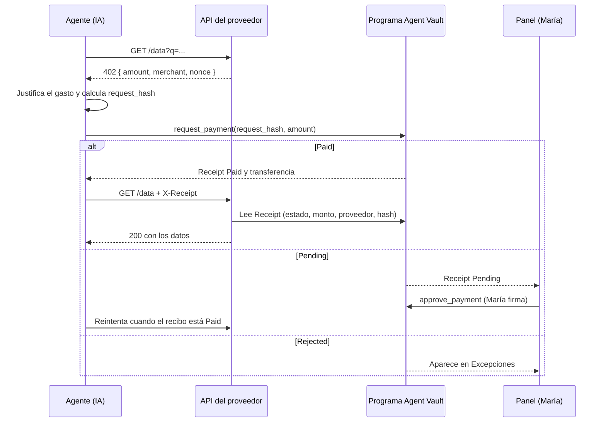

# Intent: Agent Vault

- **Estado:** listo para construir · prototipo de hackathon
- **Evento:** [MLH Solana Hackathon](https://events.mlh.com/events/15200-solana-hackathon), 6–8 nov. 2026 (cierre final: dom 8 nov., 11:45 a. m., hora de Panamá)
- **Tracks:** AI (y Top 3 Overall)
- **Responsable:** José Arnulfo R. H.
- **Última actualización:** 2026-11-06

## Intención

> **La cuenta de gastos para agentes de IA.** Un agente paga a servicios que cobran por consulta en centavos y en segundos, con reglas en la cadena que no puede saltarse y un recibo auditable por cada intento de pago, aprobado o no.

## Problema

Las empresas no le dan dinero a un agente de IA por dos motivos:

1. **Control:** una billetera libre o una tarjeta sin límite por consulta es un riesgo.
2. **Auditoría:** un estado de cuenta muestra cuánto y a quién, pero no **qué pidió el agente, por qué ni qué recibió**.

**¿Por qué no una tarjeta?** Para facturas y suscripciones, la tarjeta corporativa gana. Agent Vault apunta a lo que la tarjeta no puede hacer: pagos de US$0.01 por consulta (una tarjeta cobra ~2.9 % + US$0.30), a proveedores sin cuenta previa (flujo [x402](https://www.x402.org/)), con liquidación en segundos. El análisis completo, con fuentes y la proyección a Panamá y al mundo, está en la tesis del producto, en las notas del hackathon (repositorio DEV, `programas/solana-hackathon-2026-11/notas.md`).

## Usuarios

| Rol | Persona de la demo | Qué hace en Agent Vault |
| --- | --- | --- |
| Dueño (finanzas) | **María**, controller de una agencia de 20 personas | Crea la bóveda, fija el presupuesto, los proveedores y el umbral, y aprueba los pagos pendientes |
| Agente | Agente de investigación | Pide datos a APIs de pago y paga desde la bóveda |
| Proveedor | API de datos que cobra por consulta | Responde `402`, verifica el pago y entrega |

## Alcance

**Dentro (hackathon):**

- Programa Anchor con políticas: hasta 5 proveedores permitidos, tope diario, umbral de aprobación humana, pausa y retiro.
- Un **recibo en la cadena por cada intento de pago**, ligado a la solicitud del agente mediante `request_hash`.
- API de pago al estilo x402 que responde `402`, verifica el recibo y entrega el recurso.
- Agente con IA que decide qué consultar y justifica cada gasto.
- Panel con los pagos aprobados, los pendientes (con botón para aprobar) y las excepciones.
- Despliegue en devnet con un token de prueba de 6 decimales que hace las veces de USDC.

**Fuera (dejar explícito en el README y en el video):**

- Integración x402 completa con un *facilitator* real o con el SDK oficial.
- USDC real, mainnet o auditoría de seguridad.
- Token-2022, múltiples agentes por bóveda y edición de políticas después de crearlas (salvo pausar).
- Facturas como caso de uso.

## Estado actual

Ya está hecho en `programs/agent_vault/src/lib.rs`:

- [x] `initialize` (agente, hasta 5 proveedores, mint, tope diario y umbral), `agent_pay`, `set_paused` y `owner_withdraw`
- [x] `request_payment`, `approve_payment` y `reject_payment` con recibos PDA
- [x] Estados `Paid`, `Pending` y `Rejected`, razones de rechazo y eventos de creación/liquidación
- [x] Tope diario con reinicio a medianoche UTC; error si el reloj retrocede o hay desbordamiento
- [x] El proveedor se valida por el dueño de la cuenta de token destino y la lista inmutable de proveedores
- [x] Evento `PaymentMade`
- [x] `anchor build` y `anchor test` pasan: 3 pruebas unitarias y 9 pruebas de integración LiteSVM (`programs/agent_vault/tests/vault.rs`)
- [x] Cliente TS generado con Codama; `setup-devnet.ts` y `smoke.ts` escritos y compilando (`tsc` sin errores)
- [ ] Nada desplegado en devnet; sin API, agente ni panel
- [ ] Repositorio privado hasta H5 (se publica el sáb 7 después del ensayo)

## Decisiones de diseño

### D1. Los rechazos por política no revierten la transacción

En Solana, si una instrucción falla se pierde **todo**, incluidos los eventos y los cambios de cuentas. Si `agent_pay` lanzara un error al pasarse del tope, el intento no quedaría registrado y no habría informe de excepciones.

**Decisión:** la nueva instrucción `request_payment` siempre crea un recibo y solo transfiere si se cumple la política:

| Caso | Resultado |
| --- | --- |
| Firmante que no es el agente, mint equivocado, monto 0 | **Revierte** (es un error de llamada, no una decisión de política) |
| Bóveda en pausa, proveedor no permitido o tope diario superado | Recibo `Rejected { reason }`, sin transferencia |
| Monto mayor que `approval_threshold` | Recibo `Pending`, sin transferencia |
| Todo en regla | Transferencia y recibo `Paid` |

### D2. El recibo es un PDA por solicitud y evita la repetición

- Semillas: `["receipt", vault, request_hash]`.
- Como el PDA se crea con `init`, **no se puede usar dos veces el mismo `request_hash`**, así que un mismo pago no se puede repetir.
- `request_hash = sha256(JSON canónico de la solicitud)`: URL del recurso, proveedor, monto, motivo escrito por el agente y *nonce* del `402`. El JSON completo se guarda fuera de la cadena (en el panel o la API) y cualquiera puede recalcular el hash.
- Quien paga la renta del recibo es el agente (mejora futura: cerrar recibos viejos para recuperarla).

### D3. Aprobación humana

- `approve_payment(receipt)`, firmada por el dueño: si el recibo está `Pending`, vuelve a validar la pausa y el tope diario, transfiere y lo marca `Paid`.
- `reject_payment(receipt)`, firmada por el dueño: lo marca `Rejected { OwnerRejected }`.
- La aprobación **no salta el tope diario**. El dueño que necesite más debe retirar fondos o crear otra política.

### D4. Lista de proveedores

`merchants: [Pubkey; 5]` con `merchant_count: u8`, todo fijado en `initialize`. Se sigue validando el **dueño** de la cuenta de token destino.

### D5. `agent_pay` se mantiene

Queda como ruta simple y compatible con las pruebas actuales. La demo y la API usan `request_payment`. Si sobra tiempo, `agent_pay` se elimina o pasa a delegar en la nueva instrucción.

## Especificación del programa

### Cuentas

```rust
pub struct Vault {               // semillas: ["vault", authority]
    pub authority: Pubkey,
    pub agent: Pubkey,
    pub mint: Pubkey,
    pub merchants: [Pubkey; 5],
    pub merchant_count: u8,
    pub daily_limit: u64,
    pub approval_threshold: u64, // montos > umbral quedan Pending
    pub spent_today: u64,
    pub day_index: i64,
    pub paused: bool,
    pub bump: u8,
}

pub struct Receipt {             // semillas: ["receipt", vault, request_hash]
    pub vault: Pubkey,
    pub request_hash: [u8; 32],
    pub merchant: Pubkey,        // dueño de la cuenta destino
    pub merchant_tokens: Pubkey, // cuenta de token destino
    pub amount: u64,
    pub status: ReceiptStatus,   // Paid | Pending | Rejected
    pub reason: RejectReason,    // None | Paused | MerchantNotAllowed | DailyLimit | OwnerRejected
    pub created_at: i64,
    pub settled_at: i64,
    pub bump: u8,
}
```

### Instrucciones

| Instrucción | Firmante | Cambio |
| --- | --- | --- |
| `initialize(agent, merchants, daily_limit, approval_threshold)` | Dueño | Se amplía con la lista y el umbral |
| `request_payment(request_hash, amount)` | Agente | **Nueva.** Crea `Receipt`; paga, deja pendiente o rechaza según D1 |
| `approve_payment()` | Dueño | **Nueva.** `Pending` → `Paid` |
| `reject_payment()` | Dueño | **Nueva.** `Pending` → `Rejected` |
| `set_paused(paused)` | Dueño | Sin cambio |
| `owner_withdraw(amount)` | Dueño | Sin cambio |
| `agent_pay(amount)` | Agente | Se mantiene (D5) |

### Eventos

`ReceiptCreated { vault, receipt, request_hash, merchant, amount, status, reason }` y `ReceiptSettled { vault, receipt, status }`. Son útiles para el panel en tiempo real, pero **la fuente de verdad son las cuentas `Receipt`** (se leen con `getProgramAccounts` filtrando por `vault`).

## Arquitectura



### Estructura de carpetas propuesta

```text
programs/agent_vault/   programa Anchor (existente)
clients/js/             cliente TS generado con Codama desde el IDL
api/                    servidor del proveedor (402 + verificación de Receipt)
agent/                  agente con IA (script de Node)
app/                    panel web (Vite + React)
scripts/                setup-devnet: mint de prueba, bóveda, fondos
```

### Pila

- **Programa:** Anchor 1.2.2, Rust 1.89, SPL Token clásico, pruebas con LiteSVM.
- **Cliente:** TypeScript con `@solana/kit` y un cliente generado con Codama (lo que recomienda la skill `solana-dev`).
- **API:** Node con un servidor HTTP mínimo (Hono o Express).
- **Agente:** Node con un modelo de Claude para elegir la consulta y redactar el motivo del gasto. La IA hace trabajo real: decide **qué comprar y por qué**, y ese motivo entra en el `request_hash`.
- **Panel:** Vite + React con conexión de billetera para que María apruebe.

### Verificación en la API (antes de entregar)

1. El recibo existe, pertenece a la bóveda esperada y su estado es `Paid`.
2. `merchant` coincide con el proveedor y `amount` es mayor o igual que el precio.
3. El `request_hash` del recibo coincide con el hash de la solicitud que llega, incluido el *nonce* que emitió la API.
4. El *nonce* no se había usado antes (registro en memoria basta para la demo).

## Plan por hitos (hora de Panamá)

### H1. Programa con recibos · vie 6, tarde y noche

- [x] Hacer el primer commit del estado actual (el repositorio sigue privado; se publica en H5)
- [x] Ampliar `Vault` (lista de proveedores, umbral) y `initialize`
- [x] `Receipt`, `ReceiptStatus` y `RejectReason`
- [x] `request_payment` según D1 y D2
- [x] `approve_payment` y `reject_payment`
- [x] Eventos `ReceiptCreated` y `ReceiptSettled`
- [x] Pruebas LiteSVM: Paid, Pending → aprobado, Pending → rechazado, proveedor no permitido, tope, pausa, `request_hash` repetido, firmante equivocado
- [x] `anchor build` y `anchor test` en verde

**Listo cuando:** las pruebas de integración pasan (9 al 6 nov.) y las 3 unitarias siguen en verde.

### Convenciones para H2–H5

Todos los hitos siguientes usan este formato:

- **Objetivo:** el resultado en una frase.
- **Entradas:** lo que tiene que existir antes de empezar.
- **Entregables:** archivos o artefactos concretos.
- **Tareas:** en orden de ejecución.
- **Criterios de aceptación:** comprobables por otra persona, sin preguntarte nada.
- **Evidencia:** lo que se guarda para el README y el video.
- **Plan B:** qué recortar si el *timebox* se agota.

**Definición de terminado de cualquier hito:** criterios en verde, `anchor test` sigue pasando, commit con un mensaje descriptivo y una línea en la bitácora del hackathon.

---

### H2. Devnet, entorno de demo y cliente · vie 6, 7:00 – 11:00 p. m.

**Objetivo:** el programa vive en devnet, con un entorno de demo reproducible desde cero con un solo comando y un cliente tipado que usan la API, el agente y el panel.

**Entradas:** H1 en verde, IDL en `target/idl/agent_vault.json`, CLI en devnet con 4.24 SOL.

**Entregables:**

| Archivo | Contenido |
| --- | --- |
| `keys/` *(ignorada por Git)* | `maria-keypair.json`, `agent-keypair.json`, `merchant-research-keypair.json`, `merchant-unknown-keypair.json` |
| `scripts/setup-devnet.ts` | Crea el mint, la bóveda, el depósito y las cuentas de token; es idempotente |
| `config/devnet.json` | Direcciones públicas generadas (program ID, mint, bóveda, proveedores). **Sí** va a Git |
| `clients/js/` | Cliente generado con Codama desde el IDL |
| `package.json` *(workspace)* | Espacios de trabajo `clients/js`, `api`, `agent`, `app`, `scripts` |

**Parámetros de la demo** (en unidades base, 6 decimales):

| Parámetro | Valor | Equivale a |
| --- | --- | --- |
| Depósito inicial | `50_000_000` | 50 tokens |
| `daily_limit` | `10_000_000` | 10 tokens por día |
| `approval_threshold` | `1_000_000` | Más de 1 token requiere aprobación |
| Precio de una consulta | `10_000` | 0.01 tokens |
| Precio de un informe | `5_000_000` | 5 tokens: cae en Pending |
| Proveedores permitidos | `merchant-research` | `merchant-unknown` **no** está en la lista: cae en Rejected |

**Tareas:**

- [x] Agregar `keys/` a `.gitignore` y comprobar con `git check-ignore keys/x.json` *(comprobado el 6 nov.)*
- [ ] Generar los 4 pares de llaves; fondear a María y al agente con 0.2 SOL cada uno desde la billetera de desarrollo (el agente paga la renta de los recibos)
- [ ] Confirmar que `declare_id!` coincide con `target/deploy/agent_vault-keypair.json`; desplegar con `anchor deploy --provider.cluster devnet`
- [ ] Anotar el tamaño del binario y el costo real del despliegue. Presupuesto máximo: **2.5 SOL**. Si el despliegue se interrumpe, recuperar el *buffer* con `solana program close --buffers`
- [ ] `setup-devnet.ts`: *(escrito; falta ejecutarlo en devnet)* mint de prueba propio (6 decimales, autoridad de María), bóveda con los parámetros de la tabla, depósito y escritura de `config/devnet.json`
- [x] Generar el cliente con Codama (`clients/js/src/generated/`)
- [ ] `smoke.ts` que llama `request_payment` con 0.01 y lee el recibo *(escrito; falta ejecutarlo)*
- [ ] Importar la llave de María a Phantom (red devnet) para firmar desde el panel en H4

**Criterios de aceptación:**

- [ ] `solana program show <PROGRAM_ID> --url devnet` muestra el programa con tu billetera como autoridad de actualización
- [ ] Borrar `config/devnet.json` y correr `npm run setup:devnet` deja todo listo sin pasos manuales
- [ ] `npm run smoke` imprime una firma, y el recibo leído tiene `status = Paid`, el monto correcto y el `request_hash` enviado
- [ ] `git status` no muestra ningún archivo de `keys/`

**Evidencia:** enlaces al explorador del despliegue y del primer pago (`https://explorer.solana.com/tx/<firma>?cluster=devnet`), guardados en `docs/devnet.md`.

**Plan B:** si Codama se atasca más de 45 minutos, usar el cliente TS de Anchor con el IDL, o construir las instrucciones a mano con `@solana/kit`. No se cambia el programa para acomodar al cliente.

---

### H3. API del proveedor y agente con IA · sáb 7, 8:00 a. m. – 12:30 p. m.

**Objetivo:** un agente responde preguntas comprando datos a una API que cobra por consulta, sin intervención humana salvo en los pagos que superan el umbral.

**Entradas:** H2 completo, `config/devnet.json`, cliente generado y una clave de API del modelo en `agent/.env` (ignorado por Git).

#### Contrato de la API (`api/`)

| Ruta | Respuesta |
| --- | --- |
| `GET /v1/research?q=…` sin pago | `402` con la oferta de pago (abajo) |
| `GET /v1/research?q=…` con `X-Payment-Request` | `200` con los datos y el encabezado `X-Receipt: <dirección PDA>`; o el error correspondiente |
| `GET /v1/report?topic=…` | Igual que la anterior, con precio de 5 tokens |
| `POST /v1/audit` | Guarda el documento de solicitud; la clave es su `sha256`, y la API rechaza el documento si el hash no coincide |
| `GET /v1/audit/:hash` | Devuelve el documento para que cualquiera recalcule el hash |

Cuerpo del `402`:

```json
{
  "scheme": "agent-vault-v0",
  "resource": "/v1/research?q=solana+fees",
  "amount": "10000",
  "mint": "<MINT>",
  "merchant": "<MERCHANT_PUBKEY>",
  "merchantTokens": "<MERCHANT_ATA>",
  "nonce": "<uuid v4>",
  "expiresAt": "2026-11-07T15:05:00Z"
}
```

**Documento de solicitud** (lo arma el agente; su `sha256` es el `request_hash`). JSON canónico: claves en orden alfabético, sin espacios, UTF-8:

```json
{"amount":"10000","merchant":"<…>","nonce":"<…>","reason":"<motivo escrito por el agente>","resource":"/v1/research?q=solana+fees","vault":"<…>"}
```

**Verificación en el reintento** (todas obligatorias):

1. Decodificar `X-Payment-Request` (base64) y recalcular `sha256`.
2. Derivar el recibo con `["receipt", vault, request_hash]` y leerlo con *commitment* `confirmed`. El agente no puede señalar otro recibo, porque la API deriva la dirección por su cuenta.
3. Comprobar que `status = Paid`, que `merchant` es este proveedor, que `amount` es mayor o igual que el precio y que `resource` coincide con la ruta pedida.
4. Comprobar que el `nonce` lo emitió esta API, que no expiró (5 minutos) y que no se ha usado. Al entregar, se marca como usado.

| Caso | Código | Cuerpo |
| --- | --- | --- |
| Recibo `Pending` | `402` | `{ "status": "pending_approval" }` |
| Recibo `Rejected` | `403` | `{ "status": "rejected", "reason": "…" }` |
| Recibo inexistente o hash distinto | `402` | Oferta nueva |
| `nonce` usado | `409` | — |
| `nonce` expirado | `410` | — |

#### Agente (`agent/`)

- **Modelo:** Claude Sonnet 5.5 (`claude-sonnet-5-5`) con *tool use*.
- **Herramientas que expone al modelo:**
  - `get_budget()`: devuelve el saldo, el tope y lo gastado hoy, leídos de la cadena.
  - `buy(resource, reason)`: hace el ciclo completo de `402` → auditoría → `request_payment` → reintento.
  - `wait_for_approval(receipt)`: consulta el recibo cada 3 s durante un máximo de 120 s.
- **Reglas del sistema (*prompt*):** escribir un `reason` concreto (qué necesita y para qué) antes de cada compra, no comprar lo mismo dos veces, consultar el presupuesto antes de un gasto mayor que el umbral y no reintentar un pago `Rejected`.
- **Registro:** cada ejecución escribe `agent/runs/<fecha>.jsonl` con la pregunta, las decisiones, las firmas y los recibos.
- **Interfaz:** `npm run agent -- "¿Cuánto cuesta una transacción en Solana y cómo se compara con Visa?"`

**Tareas:**

- [ ] API: oferta `402`, almacén de *nonces* en memoria, `/v1/audit` y verificación de los 4 pasos
- [ ] Biblioteca compartida `clients/js/request.ts`: JSON canónico, `sha256` y derivación del PDA, usada **igual** por la API, el agente y el panel
- [ ] Prueba de la biblioteca: el mismo documento produce el mismo hash en las tres apps
- [ ] Agente: herramientas, ciclo con el modelo, manejo de Pending, Rejected y errores de red
- [ ] Datos de la API: respuestas fijas pero realistas (decisión rápida; un modelo real es opcional)

**Criterios de aceptación:**

- [ ] Camino Paid: con una pregunta el agente hace al menos 2 compras de 0.01 y responde citando lo comprado
- [ ] Camino Pending: el agente pide un informe y espera; al aprobarlo con un script, la API entrega
- [ ] Camino Rejected: si se fuerza al proveedor `merchant-unknown`, el agente informa el rechazo y no reintenta
- [ ] Reenviar el mismo `X-Payment-Request` devuelve `409`
- [ ] Cambiar un carácter del `reason` en el reintento devuelve `402`, porque el hash ya no coincide

**Evidencia:** un `runs/*.jsonl` de cada camino y una grabación de la terminal.

**Plan B:** si el ciclo con el modelo falla, el agente sigue un guion fijo de compras, pero el `reason` lo sigue redactando el modelo en una llamada simple. La IA nunca se elimina por completo.

---

### H4. Panel de María · sáb 7, 12:30 – 2:00 p. m.

**Objetivo:** María ve en una pantalla en qué gastó su agente, aprueba o rechaza lo pendiente y comprueba cualquier recibo.

**Entradas:** H3 completo, Phantom con la llave de María en devnet.

**Pantalla única (`app/`, Vite + React):**

| Zona | Contenido | Fuente |
| --- | --- | --- |
| Encabezado | Saldo de la bóveda, gasto de hoy contra el tope (barra), estado y botón **Pausar** o **Reanudar** | Cuenta `Vault` y cuenta de token |
| Pestañas | **Pagados**, **Pendientes** (con contador) y **Excepciones** | `getProgramAccounts` con filtro `memcmp` por bóveda |
| Fila | Fecha, proveedor (con nombre legible), monto, motivo resumido, enlace al explorador | Recibo y `/v1/audit/:hash` |
| Acciones | **Aprobar** y **Rechazar** en Pendientes, firmados con Phantom | `approve_payment` y `reject_payment` |
| Detalle | Documento de solicitud completo y el sello **Hash verificado ✓** o **No coincide ✗**, calculado en el navegador | Biblioteca compartida de H3 |

**Tareas:**

- [ ] Conexión de billetera con `@solana/kit` y Wallet Standard; mostrar un aviso claro si la red no es devnet
- [ ] Lectura de la bóveda y los recibos; actualización cada 3 s (suscripción a cuentas solo si sobra tiempo)
- [ ] Pestañas, filas y detalle con verificación del hash
- [ ] Aprobar, Rechazar y Pausar, con estados de carga, error y éxito con enlace a la transacción
- [ ] Montos siempre en tokens con 2 decimales, nunca en unidades base

**Criterios de aceptación:**

- [ ] Un pago hecho por el agente aparece en el panel en menos de 5 s
- [ ] Aprobar un pendiente desde Phantom lo mueve a Pagados y el agente recibe el informe
- [ ] Si la bóveda está en pausa, el siguiente intento del agente aparece en Excepciones con el motivo «En pausa»
- [ ] El detalle de un recibo muestra **Hash verificado ✓**; si se altera el documento en el almacén, muestra **No coincide ✗**
- [ ] Se usa sin errores a 1280 px y no se rompe a 390 px

**Evidencia:** 3 capturas (resumen, pendiente aprobado y detalle verificado) en `docs/screenshots/`.

**Plan B:** si la billetera en el navegador da problemas, el panel queda en solo lectura y la aprobación se hace con `npm run approve -- <recibo>`, mostrándola en el video.

> **🧊 Sáb 7, 2:00 p. m.: se congela el alcance.** A partir de aquí solo se corrigen errores, se pule el texto y se prepara la entrega. Nada nuevo, aunque sea «pequeño».

---

### H5. Ensayo, documentación y entrega · sáb 7, 2:00 p. m. – dom 8, 11:00 a. m.

**Objetivo:** un juez entiende el producto en 2 minutos, puede comprobar en devnet que es real y sabe exactamente qué no hace.

**Entradas:** H4 completo y alcance congelado.

**Ensayo general (sáb, 2:00 – 3:30 p. m.):**

- [ ] Entorno desde cero: `npm run setup:devnet`, luego la API, el agente y el panel siguiendo **solo** el README
- [ ] Recorrer los 4 caminos del guion dos veces seguidas sin tocar código
- [ ] Anotar cada tropiezo y corregir solo eso
- [ ] **Publicar el repositorio** al terminar el ensayo (sáb 3:30 p. m.), después de revisar que no haya llaves en todo el historial (`git log -p`); límite: antes de la entrega inicial

**README en inglés (sáb, 3:30 – 6:00 p. m.)**, en este orden:

1. Una frase y una captura del panel
2. *The problem* y *Why not a corporate card?* (tabla de comparación)
3. *How it works*: diagrama de secuencia y tabla de instrucciones
4. *Live on devnet*: program ID y enlaces al explorador de un pago Paid, uno Pending → aprobado y uno Rejected
5. *Run it yourself*: requisitos y comandos en orden
6. *Security model*: qué hace cumplir el programa y qué queda fuera (API, agente)
7. *Limitations*: token de prueba, flujo **al estilo** x402, sin auditoría, devnet
8. *What's next*: integración x402 completa, USDC real, varios agentes y el piloto en Panamá

**Video (sáb, 6:00 – 9:00 p. m.):**

| Tiempo | Escena | En pantalla |
| --- | --- | --- |
| 0:00–0:15 | Problema: María no le da una tarjeta a su agente | Título y una frase |
| 0:15–0:30 | Por qué no una tarjeta: US$0.30 de comisión contra una consulta de US$0.01 | Tabla |
| 0:30–1:00 | Paid: el agente compra y responde | Terminal y panel lado a lado |
| 1:00–1:15 | Rejected: proveedor fuera de la lista | Pestaña Excepciones |
| 1:15–1:35 | Pending: informe de 5 tokens; María aprueba con Phantom | Panel y billetera |
| 1:35–1:50 | Auditoría: detalle con **Hash verificado ✓** y el explorador | Detalle y explorador |
| 1:50–2:00 | Cierre y enlace al repositorio | Una frase |

- [ ] Grabar en 1080p; audio limpio; cursor visible
- [ ] Subtítulos en inglés **activados por defecto** (incrustados en el video, no opcionales)
- [ ] Subir a YouTube como «No listado» y comprobar que se ve en una ventana privada

**Entrega en MLH:**

- [ ] Repositorio público con licencia MIT; sin llaves (`git log -p | grep -i "secret\|private"` vacío)
- [ ] Ficha del proyecto: nombre, frase, descripción, tecnologías (Solana, Anchor, Rust, TypeScript, Claude), enlaces al repositorio, al video y a devnet
- [ ] Tracks: **AI** y Top 3 Overall
- [ ] **Dom 8, 9:30 a. m.:** entrega inicial (cierra a las 10:00)
- [ ] **Dom 8, 11:00 a. m.:** entrega final y tracks (cierra a las 11:45)

**Criterios de aceptación:**

- [ ] Una persona que no conoce el proyecto lo explica con sus palabras después de ver el video
- [ ] Todos los enlaces del README responden (se revisan con un verificador de enlaces)
- [ ] El repositorio se clona en una carpeta limpia y `anchor test` pasa
- [ ] La entrega aparece como enviada en MLH antes de las 11:00 a. m.

**Plan B:** si el sábado a las 9:00 p. m. el video no está, se graba una sola toma con la demo y se ponen los subtítulos el domingo temprano. La entrega inicial de las 9:30 a. m. se hace **siempre**, aunque esté incompleta, y se completa antes del cierre final.

## Guion de la demo (2 minutos)

1. **Problema** (15 s): «María no le da una tarjeta a su agente».
2. **Paid:** el agente compra 3 consultas, cada una de un centavo; se ven los recibos y la transacción en el explorador.
3. **Rejected:** el agente intenta pagarle a un proveedor que no está en la lista y aparece en Excepciones sin mover dinero.
4. **Pending:** el agente pide un informe de US$5, la operación queda pendiente y María lo aprueba desde el panel.
5. **Auditoría:** se abre un recibo con el motivo escrito por el agente, el hash recalculado y la transacción.
6. **Cierre** (10 s): «Las tarjetas son para gastos normales; Agent Vault es para los pagos que la tarjeta no puede hacer».

## Criterios de éxito

- [ ] Los 4 caminos de la demo (Paid, Rejected, Pending → aprobado, auditoría) funcionan en devnet sin trucos
- [ ] Si se quita Solana, el producto deja de funcionar: las reglas y los recibos viven en la cadena
- [ ] La IA decide qué comprar y por qué, no solo dispara el pago
- [ ] El README dice claramente qué no hace

## Riesgos y respuestas

| Riesgo | Respuesta |
| --- | --- |
| El cambio de cuentas rompe las pruebas actuales | Ajustar primero `initialize` en las pruebas; mantener `agent_pay` (D5) |
| Codama o `@solana/kit` cuestan más de lo previsto | Plan B: el cliente de Anchor en TS, o construir las instrucciones a mano |
| Se acaba el SOL de devnet | Faucet con GitHub; LiteSVM para todo lo que no sea la demo |
| El panel no llega | La demo se hace con el CLI del agente y el explorador; el panel es opcional después del congelamiento |
| Falta tiempo para la IA | El agente usa una lista fija de preguntas, pero el motivo del gasto lo sigue escribiendo el modelo |

## Reglas de trabajo

- Nada de llaves, frases semilla ni `.env` en Git (lo cubre `.gitignore`).
- Cada hito termina con `anchor test` en verde y un commit.
- Montos siempre en unidades base (6 decimales: `1_000_000` = 1 token).
- No decir «USDC» ni «x402 completo» en la demo: decir «token de prueba» y «flujo al estilo x402».

## Preguntas abiertas

- [ ] ¿La API de la demo usa un modelo real (por ejemplo Gemma local) o datos fijos?
- [ ] ¿El agente corre con Claude o con un modelo local?
- [ ] ¿Se buscan compañeros en `#team-building` o se sigue en solitario?

## Referencias

- [x402](https://www.x402.org/): protocolo de pagos HTTP 402
- [Comisiones en Solana](https://solana.com/docs/core/fees)
- [Your agent's wallet needs a policy, not just a signer](https://dev.to/payload-tools/your-agents-wallet-needs-a-policy-not-just-a-signer-5f4m)
- [How We Built x402 Payments for AI Agents](https://dev.to/zhasulan391/how-we-built-x402-payments-for-ai-agents-42n4)
- [My Solana Program Launch Checklist](https://dev.to/lymah/my-solana-program-launch-checklist-written-the-day-after-i-actually-did-it-1f2d)
